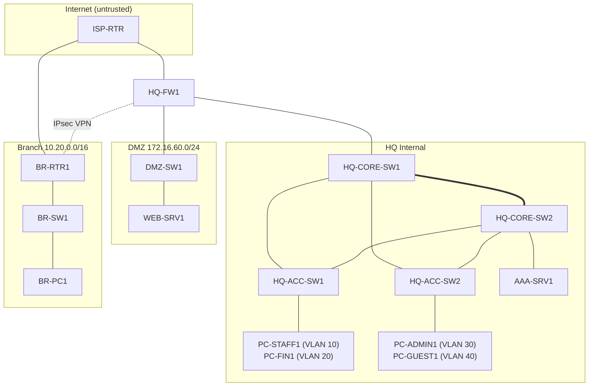

# Network Design

## Objective

Design a secure enterprise network connecting a Headquarters (HQ) and a Branch office while enforcing segmentation, redundancy, and access control.

## High-Level Topology

- HQ: core services, management, user access, security services
- Branch: remote site connectivity, local users, optional branch services
- WAN: routed connectivity between HQ and Branch
- Security boundary: firewall, ACLs, VPN, identity-based access

## Design Principles

1. Separate user, management, server, and guest traffic.
2. Use route summarization and structured addressing.
3. Apply least-privilege firewall policies.
4. Ensure redundancy where possible.
5. Centralize logging and monitoring.

## Device Inventory

| Device Name | Role | Location | Notes |
|-------------|------|----------|-------|
| HQ-CORE-SW1 | Core switch | HQ | Primary aggregation and distribution layer |
| HQ-CORE-SW2 | Core switch | HQ | Redundant core switch for resilience |
| HQ-ACC-SW1 | Access switch | HQ | User access layer |
| HQ-ACC-SW2 | Access switch | HQ | Secondary access layer |
| HQ-FW1 | Firewall | HQ | Internet edge and policy enforcement |
| DMZ-SW1 | DMZ switch | HQ | Public-facing services |
| ISP-RTR | Internet edge router | ISP | WAN/Internet provider connection |
| BR-RTR1 | Branch router | Branch | Site-to-site WAN termination |
| BR-SW1 | Branch access switch | Branch | Branch endpoint aggregation |
| WEB-SRV1 | Web server | DMZ | Public-facing server |
| AAA-SRV1 | AAA server | HQ | Authentication and accounting services |
| BR-PC1 | Branch endpoint | Branch | End-user workstation |
| USER-PCs | End-user hosts | HQ / Branch | Standard office endpoints |

## VLAN Mapping

| VLAN ID | Name | Subnet | Gateway | Purpose |
|--------|------|--------|---------|---------|
| 10 | HQ-MGMT | 10.10.10.0/24 | 10.10.10.1 | Management and infrastructure |
| 20 | HQ-USERS | 10.10.20.0/24 | 10.10.20.1 | Office users |
| 30 | HQ-SERVERS | 10.10.30.0/24 | 10.10.30.1 | Internal server resources |
| 40 | HQ-GUEST | 10.10.40.0/24 | 10.10.40.1 | Guest access |
| 50 | HQ-DMZ | 10.10.50.0/24 | 10.10.50.1 | Public-facing DMZ services |
| 110 | BR-MGMT | 10.20.10.0/24 | 10.20.10.1 | Branch management |
| 120 | BR-USERS | 10.20.20.0/24 | 10.20.20.1 | Branch user LAN |
| 130 | BR-SERVICES | 10.20.30.0/24 | 10.20.30.1 | Branch local services |
| 140 | BR-GUEST | 10.20.40.0/24 | 10.20.40.1 | Guest access |
| 999 | NATIVE/UNUSED | - | - | Reserved for future use or lab expansion |

## IP Allocation per Interface

| Device | Interface | IP Address | Mask | Description |
|--------|-----------|-----------|------|-------------|
| ISP-RTR | Gi0/0 | 203.0.113.1 | /30 | Provider-facing internet side |
| ISP-RTR | Gi0/1 | 172.16.10.1 | /30 | WAN side to branch router |
| HQ-FW1 | Outside | 203.0.113.2 | /30 | Internet-facing firewall interface |
| HQ-FW1 | Inside | 10.10.1.1 | /24 | Core connectivity to HQ internal network |
| HQ-FW1 | DMZ | 10.10.50.1 | /24 | DMZ firewall interface |
| HQ-CORE-SW1 | VLAN 10 | 10.10.10.1 | /24 | Management SVI |
| HQ-CORE-SW1 | VLAN 20 | 10.10.20.1 | /24 | Users SVI |
| HQ-CORE-SW1 | VLAN 30 | 10.10.30.1 | /24 | Servers SVI |
| HQ-CORE-SW1 | VLAN 40 | 10.10.40.1 | /24 | Guest SVI |
| HQ-CORE-SW1 | Link to HQ-FW1 | 10.10.1.2 | /24 | Core-to-firewall inside link |
| HQ-CORE-SW2 | VLAN 10 | 10.10.10.2 | /24 | Redundant management SVI |
| HQ-CORE-SW2 | VLAN 20 | 10.10.20.2 | /24 | Redundant users SVI |
| HQ-CORE-SW2 | VLAN 30 | 10.10.30.2 | /24 | Redundant servers SVI |
| HQ-CORE-SW2 | VLAN 40 | 10.10.40.2 | /24 | Redundant guest SVI |
| DMZ-SW1 | VLAN 50 | 10.10.50.2 | /24 | DMZ switch management/IP |
| WEB-SRV1 | NIC | 10.10.50.10 | /24 | Public web server |
| AAA-SRV1 | NIC | 10.10.30.10 | /24 | AAA and directory service |
| BR-RTR1 | WAN | 172.16.10.2 | /30 | Branch WAN link |
| BR-RTR1 | LAN | 10.20.1.1 | /24 | Branch LAN gateway |
| BR-SW1 | VLAN 110 | 10.20.10.1 | /24 | Branch management SVI |
| BR-SW1 | VLAN 120 | 10.20.20.1 | /24 | Branch user SVI |
| BR-SW1 | VLAN 130 | 10.20.30.1 | /24 | Branch services SVI |
| BR-SW1 | VLAN 140 | 10.20.40.1 | /24 | Branch guest SVI |
| BR-PC1 | NIC | 10.20.20.10 | /24 | Branch user workstation |

## Physical Cable Map

| # | From | To | Cable | Purpose |
|---|------|----|-------|---------|
| 1 | HQ-CORE-SW1 (2 ports) | HQ-CORE-SW2 (2 ports) | Copper straight (two links) | Core interconnect, later an EtherChannel |
| 2 | HQ-CORE-SW1 | HQ-ACC-SW1 | Copper straight | Uplink |
| 3 | HQ-CORE-SW1 | HQ-ACC-SW2 | Copper straight | Uplink |
| 4 | HQ-CORE-SW2 | HQ-ACC-SW1 | Copper straight | Redundant uplink |
| 5 | HQ-CORE-SW2 | HQ-ACC-SW2 | Copper straight | Redundant uplink |
| 6 | HQ-CORE-SW1 | HQ-FW1 (inside) | Copper straight | Core to firewall |
| 7 | HQ-FW1 (outside) | ISP-RTR | Copper straight | Internet link |
| 8 | HQ-FW1 (DMZ) | DMZ-SW1 | Copper straight | DMZ zone |
| 9 | ISP-RTR | BR-RTR1 | Copper straight | Branch WAN |
| 10 | BR-RTR1 | BR-SW1 | Copper straight | Branch LAN |
| 11 | Endpoints | Their switches | Copper straight | PCs on access, WEB-SRV1 on DMZ-SW1, AAA-SRV1 on HQ-CORE-SW2, BR-PC1 on BR-SW1 |

## Port Record

### HQ core and access layer

| # | From | Port | To | Port |
|---:|---|---:|---|---:|
| 1 | HQ-CORE-SW1 | Gi1/0/23 | HQ-CORE-SW2 | Gi1/0/23 |
| 2 | HQ-CORE-SW1 | Gi1/0/24 | HQ-CORE-SW2 | Gi1/0/24 |
| 3 | HQ-CORE-SW1 | Gi1/0/1 | HQ-ACC-SW1 | Gi1/0/1 |
| 4 | HQ-CORE-SW1 | Gi1/0/2 | HQ-ACC-SW2 | Gi1/0/1 |
| 5 | HQ-CORE-SW2 | Gi1/0/1 | HQ-ACC-SW1 | Gi1/0/2 |
| 6 | HQ-CORE-SW2 | Gi1/0/2 | HQ-ACC-SW2 | Gi1/0/2 |

Why two cables between the cores, and four down to the access layer? The two core cables will become one EtherChannel. The four uplinks give every access switch a path to both cores, so no single device failure cuts anyone off.

### Edge and DMZ

| # | From | Port | To | Port |
|---:|---|---:|---|---:|
| 7 | HQ-CORE-SW1 | Gi1/0/10 | HQ-FW1 | Gi1/2 (inside) |
| 8 | HQ-FW1 | Gi1/1 (outside) | ISP-RTR | Gi0/0 |
| 9 | HQ-FW1 | Gi1/3 (DMZ) | DMZ-SW1 | Fa0/1 |
| 10 | WEB-SRV1 | Fa0 | DMZ-SW1 | Fa0/2 |

Why three separate firewall ports? Each port is a different security zone (inside, outside, DMZ), and the firewall’s rules apply between them.

### Branch

| # | From | Port | To | Port |
|---:|---|---:|---|---:|
| 11 | ISP-RTR | Gi0/1 | BR-RTR1 | Gi0/0 |
| 12 | BR-RTR1 | Gi0/1 | BR-SW1 | Gi1/0/1 |
| 13 | BR-PC1 | Fa0 | BR-SW1 | Gi1/0/2 |

### Endpoints at HQ

| # | From | Port | To | Port |
|---:|---|---:|---|---:|
| 14 | PC-STAFF1 | Fa0 | HQ-ACC-SW1 | Fa0/1 |
| 15 | PC-FIN1 | Fa0 | HQ-ACC-SW1 | Fa0/2 |
| 16 | PC-ADMIN1 | Fa0 | HQ-ACC-SW2 | Fa0/1 |
| 17 | PC-GUEST1 | Fa0 | HQ-ACC-SW2 | Fa0/2 |
| 18 | AAA-SRV1 | Fa0 | HQ-CORE-SW2 | Gi1/0/10 |

Use this port record as the single source of truth: every configuration and diagram in the project should reference these entries.

## Logical Topology (Mermaid)

## Suggested Cisco Device Names and Roles

- HQ-CORE-SW1: primary distribution/core switch for HQ LAN
- HQ-CORE-SW2: redundant core switch for HA and resilience
- HQ-ACC-SW1: access switch for HQ user VLANs
- HQ-ACC-SW2: backup access switch for high availability
- HQ-FW1: Cisco firewall or security appliance for segmentation and Internet edge
- DMZ-SW1: DMZ switch for public services
- ISP-RTR: upstream provider router
- BR-RTR1: branch WAN router and default gateway
- BR-SW1: branch access distribution switch
- WEB-SRV1: DMZ web server
- AAA-SRV1: authentication, authorization, and accounting server
- BR-PC1: example branch user workstation

## Design Rationale

### 1. Redundant Core Switches (Availability)
The HQ network uses two core switches (HQ-CORE-SW1 and HQ-CORE-SW2), and every access switch has an uplink to both. If one core switch fails or goes offline, traffic continues through the other, supporting the Availability pillar of the CIA triad. Spanning Tree Protocol (STP) prevents loops across the redundant paths, and HSRP provides a default gateway that survives a core failure.

### 2. Web Server in the DMZ (Containment / Assume Breach)
The web server must accept connections from the public Internet, which makes it the most exposed system in the network and the most likely to be attacked. Placing it on the internal network would mean a single compromise gives an attacker a foothold next to sensitive systems. Instead, WEB-SRV1 sits in an isolated DMZ behind the firewall. Firewall policy allows Internet-to-DMZ traffic only on required ports (HTTP/HTTPS), blocks DMZ-to-internal traffic, and blocks Internet-to-internal traffic. If the web server is compromised, the attack is contained within the DMZ and the internal network stays protected.

### 3. Guest and Finance Segmentation (Least Privilege / Limiting Lateral Movement)
Guest users are untrusted devices. The Guest VLAN (40) is segmented from the Finance VLAN (20) so that a compromised guest device cannot move laterally into sensitive systems. VLANs separate the networks, and ACLs on the Layer 3 core enforce the boundary: Guest traffic is permitted to reach the Internet only and is denied access to all internal VLANs. This follows the principle of least privilege and limits the blast radius of any guest-side compromise.

## Security Controls

- ACLs on interfaces
- Zone-based firewall policies
- VLAN segmentation
- SSH and secure management access
- Logging to central monitoring

## Future Considerations

- SD-WAN or dual WAN connectivity
- 802.1X for endpoint access
- IDS/IPS deployment
- Multi-factor authentication for admins
